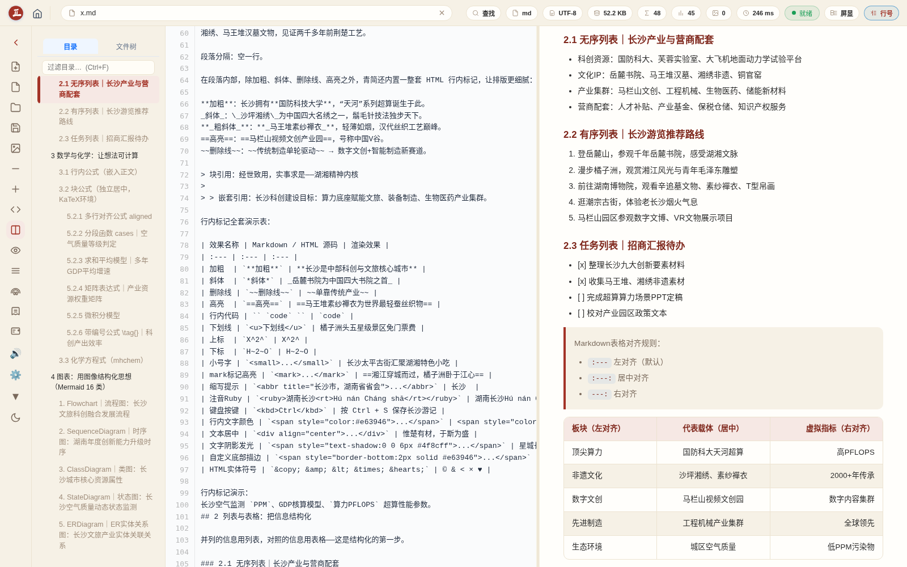
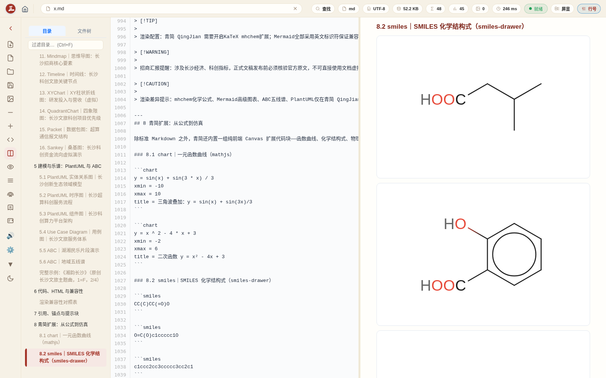
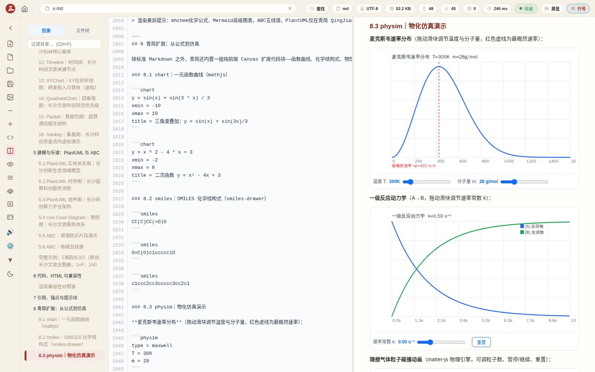
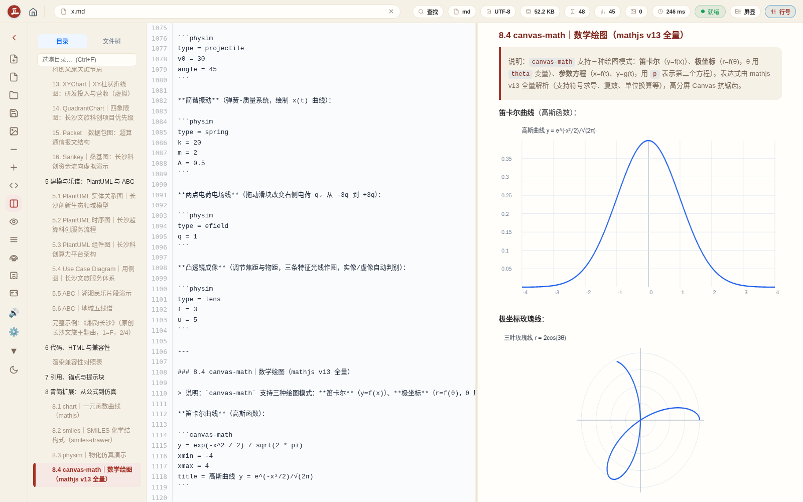
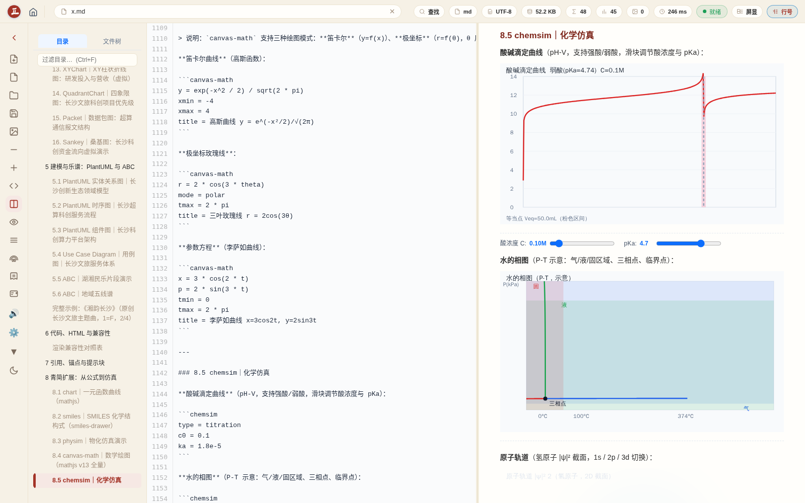
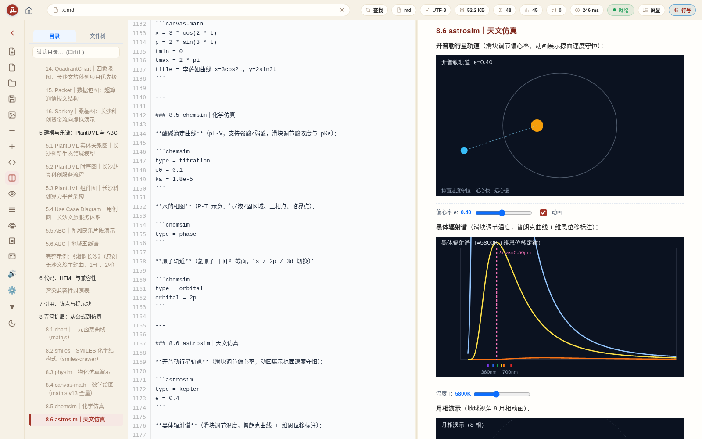
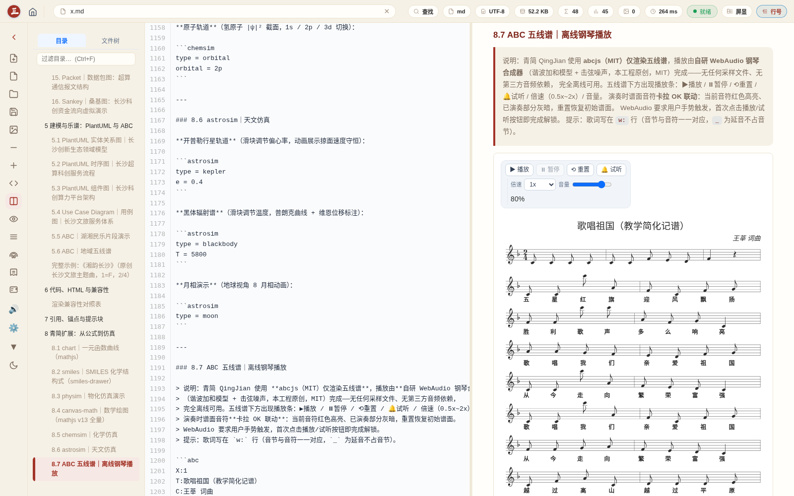
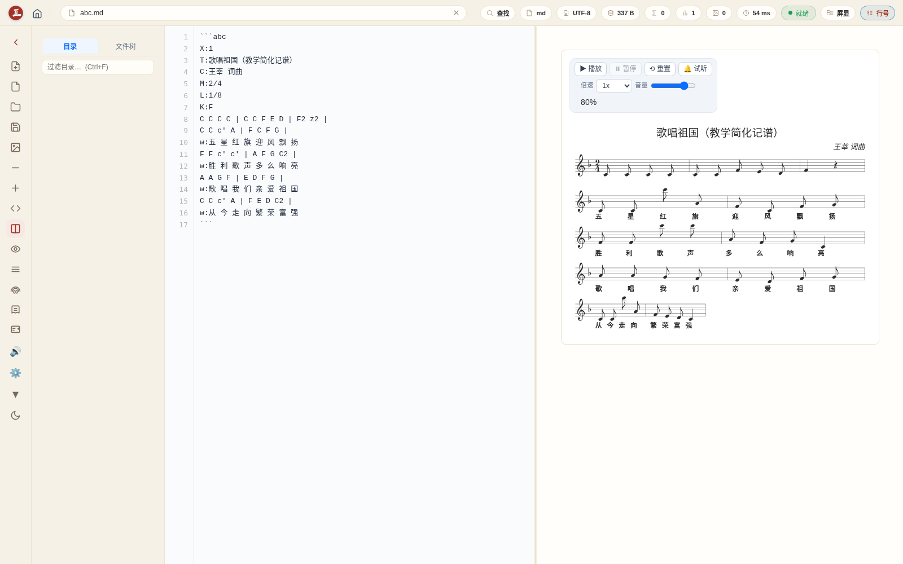

<!-- 青简 / QingJian —— GitHub 发布版简介（无版本号） -->

# 青简 · QingJian

> Bamboo Slips in Bytes, for scholarly thought.
> Write LaTeX anywhere, offline.
>
> 以字节为简，承载学术思考；离线执笔，随处可书 LaTeX。

**云端离线 · 轻量极速 LaTeX 草稿纸**
**Above-cloud Offline · Lightweight Swift LaTeX Scratchpad.**

`Offline LaTeX` `Mobile Friendly` `Lightweight` `Fast Preview` `Thinking Layer` `Airplane Mode Ready`

---

## 📖 简介 | Introduction

### ✅ 中文

**青简（QingJian）** 一个解析优先、AST 驱动、全程离线的学术写作训练场。

> 以宋代雕版之克制，承载现代 AST 解析之精密；
> 用宣纸之呼吸感，包裹字节之确定性。

无需庞大 TeX 发行版，亦不仰赖云端编译：

- 单个 HTML 文件，开箱即用；
- 仅 3.86 MB 的原生安卓 APK，让断网的智能手机，亦可在万米高空的航班上从容推演公式、打磨文稿。

全部文档永久驻留本地：零上传、零追踪、零元数据泄露；轻量架构显著降低算力开销，践行「低碳计算」的学术伦理。

青简并非 LaTeX 引擎的替代者，而是专为思想萌芽、定理推演、引文调试而设的**前编译工作台**——更本质地说，它是一张数字时代的草稿纸：不苛求终稿级排版，但每一处涂改、每一次回溯、每一条思路分叉、每一瞬灵光顿悟，皆即时呈现、毫秒响应、永不丢失。

它卸下环境配置、编译报错、依赖冲突等非学术性负重，将学者从工具的泥沼中解放——回归思想本身最本真的流动、塑形与跃迁。

适用于投稿前的反复淬炼：

- 笔记本不必常年负载数 GB 的 TeX 套件；
- 待文思澄明、结构臻善，再交由标准 LaTeX 引擎终审交付。

对一篇需千锤百炼的学术论文而言，青简提供的，是一种更沉静、更专注、也更富人文温度的工作范式：

> 以字节为简，承千年竹帛之思；离线执笔，守学者精神之域。
> ▶ 青简的价值，不在它能渲染多少专业内容，而在于它以一张纸的克制，将学者从工具的迷宫中轻轻牵出——最锋利的思想，本就不需要庞大的引擎来托举。

—
> 题跋 · 七十年之约
> 欢迎体验，欢迎超越。
> 若有幸用至七十载，且年届九十，仍觉青简有所裨益，
> 请依您心意与经济能力，向所在地区任意公益组织
> 交付 9.9 元人民币／9.9 美元／9.9 欧元／9.9 英镑；
> 非上述主权货币地区，统一为 9.9 元人民币。
> 此非义务，亦无凭证——唯愿自由流转，如竹影随光。

---

### ✅ English

**QingJian** — An AST-first, fully-offline academic writing workbench.

> With the restraint of Song-dynasty woodblock printing, we embody the precision of modern AST parsing;
> with the breathing texture of rice paper, we enfold the certainty of bytes.

No bulky TeX distribution. No cloud-based compiler.

- A single self-contained HTML file — ready to run on first click.
- A 3.86 MB native Android APK — enabling formula derivation and manuscript refinement on a disconnected smartphone, even at 35,000 feet.

All documents remain permanently local: zero uploads, zero telemetry, zero metadata leakage. Its lean architecture cuts computational overhead — upholding the scholarly ethos of low-carbon computing.

QingJian does not replace LaTeX. It prepares for it: a **pre-compilation workbench**, purpose-built for idea generation, theorem derivation, and citation scaffolding. At its core, it is a digital scratchpad: it makes no claim to publication-ready typesetting — yet every revision, every rollback, every branching thought, and every flash of insight renders instantly, responds in milliseconds, and is preserved without fail.

It lifts non-scholarly burdens — environment setup, cryptic compilation errors, dependency conflicts — freeing scholars from tooling quagmires, so ideas may flow, take shape, and evolve unimpeded.

Ideal for iterative refinement before submission:

- Your laptop need no longer host multi-gigabyte TeX suites indefinitely.
- When reasoning matures and structure solidifies, hand the manuscript to a standard LaTeX engine for final validation and delivery.

For academic papers demanding repeated polishing, QingJian offers a calmer, more focused, human-centered paradigm:

> With bytes as bamboo slips — bearing millennia of scholarly thought;
> Offline composition — safeguarding the scholar's sovereign intellectual domain.
> QingJian's value lies not in the breadth of professional content it renders, but in its restraint — like a single sheet of paper — gently guiding scholars out of the labyrinth of tooling: The sharpest ideas have never needed massive engines to sustain them.

—
> Postscript · A Seventy-Year Covenant
> Try it. Transcend it.
> If, by grace, you use QingJian for seventy years — and at ninety, still find it meaningful —
> please, at your own will and means, donate ¥9.9 / $9.9 / €9.9 / £9.9
> to any local public-benefit organization.
> In regions without these currencies, please give ¥9.9 RMB.
> This is not required. No receipt is issued.
> Only this: may freedom pass on — as bamboo shadow follows light.

---

## ✨ 能力清单 | Capabilities

### 编辑与渲染 | Editing & Rendering

| 能力 | 说明 | Capability |
|---|---|---|
| **AST 语义内核** | LaTeX.js 派生，文档结构→语义树，`\label`/`\ref` 实时双向联动，无需重编译 | Live AST semantic parsing |
| **LaTeX 模板** | 15 种主流模板一键识别：acmart / IEEEtran / elsarticle / memoir / beamer / llncs / tufte / ctex / thuthesis / sn-jnl / physics 等 | 15 mainstream template engines |
| **宏包白名单** | 120+ 常用宏包直接支持，未知宏包提示不中断 | 120+ package whitelist |
| **多文件装配** | `\input` / `\include` 自动展开，学位论文分章渲染 | Multi-file assembly |
| **Markdown** | 段落/列表/表格/脚注/提示块/HTML 混写，所见即所写 | Full CommonMark + extensions |
| **数学与化学** | KaTeX + mhchem：行内/行间/矩阵/方程组/化学方程式，编号引用联动 | KaTeX + mhchem |
| **Mermaid 10.x** | 16 大类图表全量离线渲染，容器自适应缩放 + 原图切换 | Full 16-category Mermaid |
| **PlantUML** | 实体关系/时序/组件/用例四类建模图，离线渲染 | PlantUML offline |
| **ABC 五线谱** | abcjs 渲染 + 自研电子琴音色离线演奏，卡拉 OK 音符高亮，歌词逐字对位，播放条自适应缩窄 | ABC staff + offline synth |
| **扩展仿真** | chart / smiles / physim / canvas-math / chemsim / astrosim：函数曲线、化学结构式、物化/化学/天文交互仿真 | 6 interactive simulation engines |
| **源码↔预览联动** | 点击预览段落→源码对应行高亮；源码光标行→预览段落高亮；目录点击精准跳转 | Tri-pane line-level sync |
| **朗读 TTS** | 离线/在线语音朗读，句子级卡拉 OK 高亮，自动滚动跟读 | Offline + online TTS |

### 多端形态 | Build Targets

| 形态 | 说明 |
|---|---|
| 单文件 HTML | 13.2 MB，双击浏览器打开即用，零安装 |
| 分置版 | 主 HTML + assets 分置，便于二次开发 |
| Windows EXE | Tauri 单文件内嵌，系统 WebView2 Runtime |
| 安卓 APK | 3.86 MB，启动即记事本工作区，横竖屏自适应 |
| 鸿蒙壳工程 | ArkWeb 加载本地 index.html，离线全量内嵌 |

### 数据主权 | Data Sovereignty

- 全部文稿存于本地（浏览器 localStorage / 本地文件 / 安卓本地存储），零上传、零遥测、零元数据泄露；
- 全部渲染库（KaTeX / Mermaid / abcjs / PlantUML / mathjs / matter / smiles-drawer / viz）随包离线、按需懒加载；
- 网络电台仅播放用户自填的公开流地址，不内置任何直播源。

---

## 🖼 演示 | Demos（第 8 章 · 扩展仿真）

| 演示 | 文件 |
| ---- | ---- |
| chart 函数曲线 |  |
| smiles 化学结构式 |  |
| physim 物化仿真（滑块交互） |  |
| canvas-math 数学绘图 |  |
| chemsim 化学仿真 |  |
| astrosim 天文仿真 |  |
| ABC 五线谱 + 缩窄播放条 |  |
| 第 8 章全动画漫游 | <video controls width="400"><source src="./assets/qj-section8.webm"></video> |
| 《歌唱祖国》歌词对位实拍 |  |

---

## 🛡 合规审查 | Compliance Review

### 开源许可 | Licenses

| 组件 | 许可 | 说明 |
|---|---|---|
| 主体代码 | **MIT** | 自由使用/修改/再分发，保留版权声明即可 |
| 字体 | **SIL OFL 1.1** | 可自由嵌入、商用、修改（不得单独出售字体文件） |
| 图标 | **MIT** | 可自由使用 |
| PlantUML 渲染库 | **Apache-2.0** | 兼容 MIT，无传染性 |
| KaTeX / Mermaid / abcjs / mathjs / matter-js / smiles-drawer / viz / markdown-it | MIT / Apache-2.0 | 全部为宽松许可，**无 GPL 传染风险** |

> 合规要点：
> 1. 全部第三方库为宽松许可（MIT / Apache-2.0 / SIL OFL），可与闭源商业产品集成；
> 2. 自研部分（AST 内核、钢琴合成器、仿真引擎、壳程序）为 MIT 原创；
> 3. 无 GPL/AGPL 组件，无"传染性"义务；
> 4. 全离线分发：不收集、不上传任何用户数据，无第三方跟踪脚本、无广告 SDK。

### 隐私与数据 | Privacy & Data

- 所有文档、笔记、设置仅存本机；
- 无账号体系、无遥测埋点、无崩溃上报；
- 网络请求仅发生于用户主动使用的功能（网络电台、在线 TTS、远程图片），且链接来源由用户自担。

### 合规边界 | Boundary

- 青简为**解释模式**渲染：理解 LaTeX 结构语义，非完整 TeX 引擎；字体/分页/页眉页码/BibTeX 与发行版编译存在差异；
- 定稿请导出 `.tex` 源文件，使用 TeX Live / MiKTeX / Overleaf 终审交付；
- 文中演示数据（GDP/算力/排期等）均为虚拟示例，不构成真实指标。

---

## 🚀 快速上手 | Quick Start

1. 下载 `QingJian-standalone.html`，浏览器直接打开（无需联网）；
2. 欢迎页「打开文件」→ 选择 `.tex` / `.md` / `.html`；「打开文件夹」挂载目录树；
3. 模板包：点击含 `\documentclass` 的入口 `.tex`（文件树带「▶ 入口」金标）；acmart 无现成 tex 时自动 docstrip 提取；
4. 安卓：安装 APK → 启动进入记事本工作区 → 新建/打开文稿 → 离线编辑渲染 → 导出；
5. 定稿：导出 `.tex` → TeX Live / MiKTeX / Overleaf 编译。

---

## 📄 文档 | Docs

- [教程：用 LaTeX 与 Markdown 在青简中深化学术思考](./docs/tutorial.pdf)
- [模板渲染技术实现与操作指南](./docs/templates.md)
- [开源合规说明](./docs/compliance.md)

---

## 📜 License

主体代码：MIT ｜ 字体：SIL OFL ｜ 图标：MIT ｜ PlantUML：Apache-2.0

> 无 GPL 传染风险

---

> 离线是底线｜轻量是尊严｜草稿纸，是思考自由唯一的家园。
> By the Xiangjiang River · Changsha · Crafted in China · QingJian Research Center
