# 上篇 · Markdown：轻量书写，即时表达

Markdown 是思考的记录方式：语法极少、反馈即时、随处可读。上篇以长沙城市场景为例，逐一展示青简支持的书写能力——从最简单的段落，到可以交互的物理仿真。

## 1 写作的起点：段落、强调与行内标记

一篇文章从段落开始。青简遵循标准 Markdown 的书写直觉：空一行分段，行尾两个空格换行，`**`、`*`、`~~`、`==` 等符号随手即可为文字赋予层次。

普通段落：
长沙，楚汉名城、湖湘文化发源地，集聚岳麓书院、湖南博物院、马栏山文创园、国防科大等文化与科创高地，兼具深厚历史底蕴与现代产业活力，是中部地区科创、文旅、智能制造核心城市。

换行（行尾两个空格）：
湘江穿城而过，串联岳麓山、橘子洲、三馆一厅。
湘绣、马王堆汉墓文物，见证两千多年前荆楚工艺。

段落分隔：空一行。

在段落内部，除加粗、斜体、删除线、高亮之外，青简还内置一整套 HTML 行内标记，让排版更细腻：下划线、上标、下标、小号字、注音、键盘按键、文字颜色、阴影、描边等，均可直接书写。

**加粗**：长沙拥有**国防科技大学**，“天河”系列超算诞生于此。
_斜体_：\_沙坪湘绣\_为中国四大名绣之一，鬅毛针技法独步天下。
**_粗斜体_**：**_马王堆素纱襌衣_**，轻薄如烟，汉代丝织工艺巅峰。
==高亮==：==马栏山视频文创产业园==，号称中国V谷。
~~删除线~~：~~传统制造单轮驱动~~ → 数字文创+智能制造新赛道。

> 块引用：经世致用，实事求是——湖湘精神内核
> 
> > 嵌套引用：长沙科创建设目标：算力底座赋能文旅、装备制造、生物医药产业集群。

行内标记全套演示表：

| 效果名称 | Markdown / HTML 源码 | 渲染效果 |
| :--- | :--- | :--- |
| 加粗  | `**加粗**` | **长沙是中部科创与文旅核心城市** |
| 斜体  | `*斜体*` | _岳麓书院为中国四大书院之首_ |
| 删除线 | `~~删除线~~` | ~~单靠传统产业~~ |
| 高亮  | `==高亮==` | ==马王堆素纱襌衣为世界最轻蚕丝织物== |
| 行内代码 | `` `code` `` | `code` |
| 下划线 | `<u>下划线</u>` | 橘子洲头五星级景区免门票费 |
| 上标  | `X^2^` | X^2^ |
| 下标  | `H~2~O` | H~2~O |
| 小号字 | `<small>...</small>` | 长沙太平古街汇聚湖湘特色小吃 |
| mark标记高亮 | `<mark>...</mark>` | ==湘江穿城而过，橘子洲卧于江心== |
| 缩写提示 | `<abbr title="长沙市，湖南省省会">...</abbr>` | 长沙  |
| 注音Ruby | `<ruby>湖南长沙<rt>Hú nán Cháng shā</rt></ruby>` | 湖南长沙Hú nán Cháng shā |
| 键盘按键 | `<kbd>Ctrl</kbd>` | 按 Ctrl + S 保存长沙游记 |
| 行内文字颜色 | `<span style="color:#e63946">...</span>` | <span style="color: rgb(230, 57, 70);">爱晚亭秋日红叶漫山</span> |
| 文本居中 | `<div align="center">...</div>` | 惟楚有材，于斯为盛 |
| 文字阴影发光 | `<span style="text-shadow:0 0 6px #4f8cff">...</span>` | 星城长沙，夜夜烟火 |
| 自定义底部描边 | `<span style="border-bottom:2px solid #e63946">...</span>` | 天心阁是长沙古城地标 |
| HTML实体符号 | `&copy; &amp; &lt; &times; &hearts;` | © & < × ♥ |

行内标记演示：
长沙空气监测 `PPM`、GDP核算模型、`算力PFLOPS` 超算性能参数。
## 2 列表与表格：把信息结构化

并列的信息用列表，对照的信息用表格——这是结构化的第一步。

### 2.1 无序列表｜长沙产业与营商配套

-   科创资源：国防科大、芙蓉实验室、大飞机地面动力学试验平台
    
-   文化IP：岳麓书院、马王堆汉墓、湘绣非遗、铜官窑
    
-   产业集群：马栏山文创、工程机械、生物医药、储能新材料
    
-   营商配套：人才补贴、产业基金、保税仓储、知识产权服务
    

### 2.2 有序列表｜长沙游览推荐路线

1. 登岳麓山，参观千年岳麓书院，感受湖湘文脉
    
2. 漫步橘子洲，观赏湘江风光与青年毛泽东雕塑
    
3. 前往湖南博物院，观看辛追墓文物、素纱襌衣、T型帛画
    
4. 逛潮宗古街，体验老长沙烟火气息
    
5. 马栏山园区参观数字文博、VR文物展示项目
    

### 2.3 任务列表｜招商汇报待办

- [x] 整理长沙九大创新要素材料
- [x] 收集马王堆、湘绣非遗素材
- [ ] 完成超算算力场景PPT定稿
- [ ] 校对产业园区政策文本

> Markdown表格对齐规则：
> 
> -   `:---` 左对齐（默认）
>     
> -   `:---:` 居中对齐
>     
> -   `---:` 右对齐
>     

| 板块（左对齐） | 代表载体（居中） | 虚拟指标（右对齐） |
| :--- | :---: | ---: |
| 顶尖算力 | 国防科大天河超算 | 高PFLOPS |
| 非遗文化 | 沙坪湘绣、素纱襌衣 | 2000+年传承 |
| 数字文创 | 马栏山视频文创园 | 数字内容集群 |
| 先进制造 | 工程机械产业集群 | 全球领先 |
| 生态环境 | 城区空气质量 | 低PPM污染物 |

> 说明：本表全部内容仅为Markdown表格语法演示，**非官方真实数据**。
## 3 数学与化学：让想法可计算

当文字无法承载精确性，公式登场。青简内置 KaTeX 与 mhchem：行内公式用 `$...$` 嵌入正文，块级公式用 `$$...$$` 独占居中，支持多行对齐、分段函数、矩阵、编号与化学方程式。

> 说明：适配 青简 QingJian 渲染；**行内公式**使用单美元 `$...$`；
> **块公式**使用双美元 `$$...$$`；块公式支持多行对齐、分段函数、矩阵与 `\tag{}` 公式编号。所有模型为长沙城市科创、生态、经济虚拟测算模型。

### 3.1 行内公式（嵌入正文）

适用于简短表达式，直接嵌入段落文本。

-   长沙科创产出模型：$Y = A \cdot K^\alpha L^{1-\alpha}$，用于虚拟经济增长测算。
    
-   环境与经济指标：
    空气质量优良率 $P = \frac{N_{\text{优}}+N_{\text{良}}}{N_{\text{总}}} \times 100\%$；
    年度GDP增量 $\Delta G = G_{n}-G_{n-1}$；
    科创产业贡献率 $\eta = \frac{G_{\text{科创}}}{G_{\text{总}}} \times 100\%$。
    
-   月度空气污染物均值：$\bar{X} = \frac{1}{n}\sum_{i=1}^{n} X_i$
    
    > 释义：$X_i$ 为单日空气PPM监测值；$n$ 为月度有效监测天数；$\bar{X}$ 代表月度污染物平均浓度，用于量化生态环境质量。
    

**行内公式示例集合**

-   超算浮点算力：$P = N \times f \times \text{ops}$
    
-   多因子空气质量加权：$C_{\text{total}}= \sum w_i C_i$
    
-   复利增长模型：$A_t = A_0 (1+r)^t$
    

### 3.2 块公式（独立居中，KaTeX环境）

适合多行、矩阵、积分、分段函数、带编号公式，独占一行居中渲染。

#### 5.2.1 多行对齐公式 `aligned`

$$
\begin{aligned}
P_{\text{flops}} &= N_{\text{core}} \times f_{\text{clock}} \times \text{OPS}_{\text{per-cycle}} \\
E_{\text{air}} &= \sum C_i \cdot V_i
\end{aligned}
$$

> 释义：
> $P_{\text{flops}}$：超算峰值浮点算力；
> $E_{\text{air}}$：空气污染物加权综合浓度，虚拟空气质量综合指标。

长沙年度GDP增速分步推导：
$$
\begin{aligned}
G\_{\text{增速}} &= \frac{G\_{\text{本年}}-G\_{\text{上年}}}{G\_{\text{上年}}} \times 100% \
&= \frac{\Delta G}{G\_{\text{上年}}} \times 100%
\end{aligned}
$$

> 释义：用于城市经济数据汇报，由GDP增量推导同比增速。

#### 5.2.2 分段函数 `cases`｜空气质量等级判定

$$
f(x) =
\begin{cases}
\text{优质空气}, & x \leq 35 \\
\text{优良空气}, & 35 < x \leq 75 \\
\text{轻微污染}, & 75 < x \leq 115 \\
\text{轻度污染}, & x > 115
\end{cases}
$$

> 释义：$x$ 为空气PPM实时浓度；依据浓度阈值自动划分空气质量等级，实现量化分级。

#### 5.2.3 求和平均模型｜多年GDP平均增速

$$
\mathrm{GDP}_{\text{growth}} = \frac{1}{n}\sum_{i=1}^{n} g_i
$$

> 释义：$g_i$ 为单年度GDP增速；$n$ 为统计年限，计算多年平均经济增速。

#### 5.2.4 矩阵表达式｜产业资源权重矩阵

**构建长沙四大核心资源权重矩阵，用于城市综合价值评分测算：**

$$
\begin{pmatrix}
W\_{\text{文化}} & W\_{\text{科创}} \
W\_{\text{生态}} & W\_{\text{经济}}
\end{pmatrix}

\begin{pmatrix}
0.35 & 0.30 \
0.20 & 0.15
\end{pmatrix}
$$

**投入产出线性方程组：**

$$
\begin{bmatrix}
a\_{11} & a\_{12} & a\_{13}\
a\_{21} & a\_{22} & a\_{23}\
a\_{31} & a\_{32} & a\_{33}
\end{bmatrix}
\cdot
\begin{bmatrix}
x\_1 \ x\_2 \ x\_3
\end{bmatrix}

\begin{bmatrix}
b\_1 \ b\_2 \ b\_3
\end{bmatrix}
$$

#### 5.2.5 微积分模型

年度空气质量优化累计成效（积分模型）：
$$
\int\_{0}^{12} v(t),dt = \Delta Q
$$

> 释义：$v(t)$ 为月度空气优化速率；积分区间 $[0,12]$ 代表全年；$\Delta Q$ 为年度生态质量提升总量。

污染物累积滞后模型：
$$
C(T)=\int\_{0}^{T} r(t) e^{-k(T-t)} dt
$$

稳态极限表达式：
$$
\lim\_{t\to\infty} C(t) = C\_{\text{steady}}
$$

> 释义：描述污染物浓度随时间演化最终收敛至稳态浓度 $C_{\text{steady}}$。

#### 5.2.6 带编号公式 `\tag{}`｜科创产出效率

> 支持KaTeX公式编号，适合正式笔记，可在文中引用公式编号。
> $$
> E = \frac{Y}{C + R} \tag{1}
> $$
> 符号说明：
> 
> -   $E$：科创产出效率（虚拟指标，无量纲）
>     
> -   $Y$：科创产业产出，代表区域科创成果转化经济价值
>     
> -   $C$：超算算力投入
>     
> -   $R$：研发投入
>     
> -   含义：单位科创资源投入对应的产业产出；数值越高，资源利用效率越好。
>     

科创投入边际产出：
$$
\frac{\partial Y}{\partial (C+R)} \tag{2}
$$

> 释义：总资源投入的边际产出，表示新增一单位资源投入带来的科创产业产出增量。

### 3.3 化学方程式（mhchem）

> mhchem 化学式语法由青简 QingJian 内置支持；本节示例覆盖空气、材料、文物保护场景。

行内化学式：$\ce{NO2}$、$\ce{SO2}$、$\ce{O3}$、$\ce{Fe2O3}$、$\ce{H2O}$

甲烷燃烧（天然气主要成分，条件：燃烧）：
$$
\ce{CH4 + 2O2 ->\[燃烧\] CO2 + 2H2O}
$$

二氧化氮溶于水（酸雨形成）：
$$
\ce{3NO2 + H2O -> 2HNO3 + NO}
$$

二氧化硫催化氧化生成硫酸前驱物：
$$
\ce{2SO2 + O2 <=>\[催化剂\]\[\Delta\] 2SO3}
$$
$$
\ce{SO3 + H2O -> H2SO4}
$$

铁器锈蚀（马王堆出土铁质文物腐蚀）：
$$
\ce{4Fe + 3O2 + 2H2O -> 2Fe2O3\cdot H2O}
$$

蚕丝纤维素水解（素纱襌衣丝织品老化）：
$$
\ce{(C6H10O5)\_n + nH2O ->\[H+\] n C6H12O6}
$$

碳酸钙石刻酸雨溶蚀（古碑石刻风化）：
$$
\ce{CaCO3 + H2SO4 -> CaSO4 + CO2 ^ + H2O}
$$

铜离子氨络合反应：
$$
\ce{Cu^{2+} + 4NH3 <=> \[Cu(NH3)4\]^{2+}}
$$
## 4 图表：用图像结构化思想（Mermaid 16 类）

流程、时序、状态、关系、排期……一张图胜过千言。青简内置 Mermaid 10.x 全量 16 大类图表，从最简单的流程图到桑基图，全部离线渲染。以下是长沙主题的完整演示。

> 提示：青简 QingJian 对 Mermaid 中文已做包容处理（无论是否加引号均能渲染）；为保证全版本兼容，仍建议节点文本用双引号包裹、标识符优先英文。

### 1. Flowchart｜流程图：长沙文旅科创融合发展流程

**场景释义**：展示长沙以文旅资源为基底、科创技术为赋能，实现传统文化数字化、城市产业升级的核心发展逻辑。

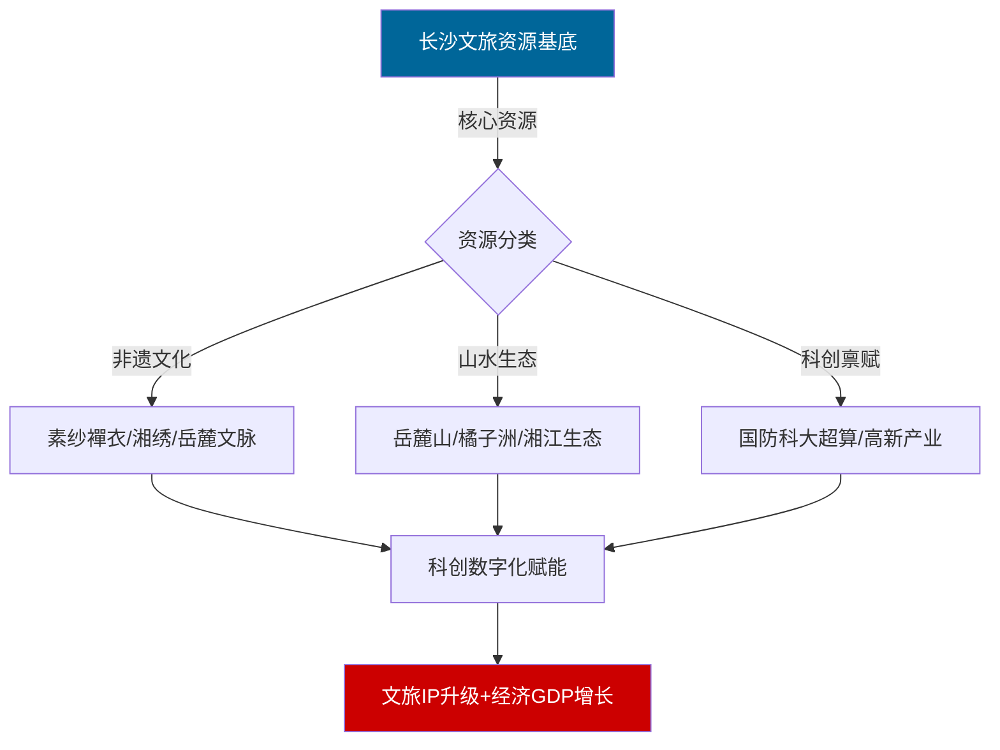

### 2. SequenceDiagram｜时序图：湖南年度创新能力升级时序

**场景释义**：还原近年湖南科创、文旅、经济迭代升级关键节点，体现城市创新能力持续提升的发展态势。

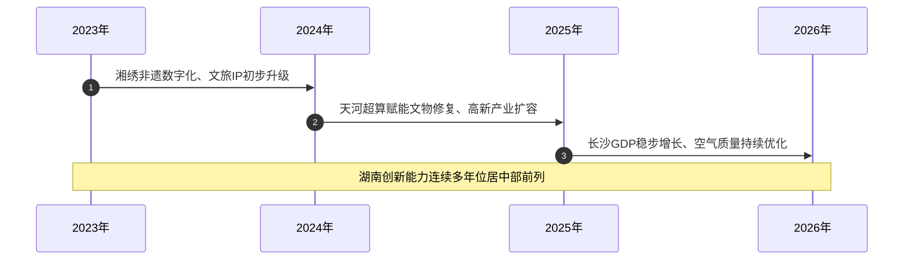

### 3. ClassDiagram｜类图：长沙城市核心资源属性

**场景释义**：结构化定义长沙生态、文化、科创、经济四大核心资源的属性与价值能力。

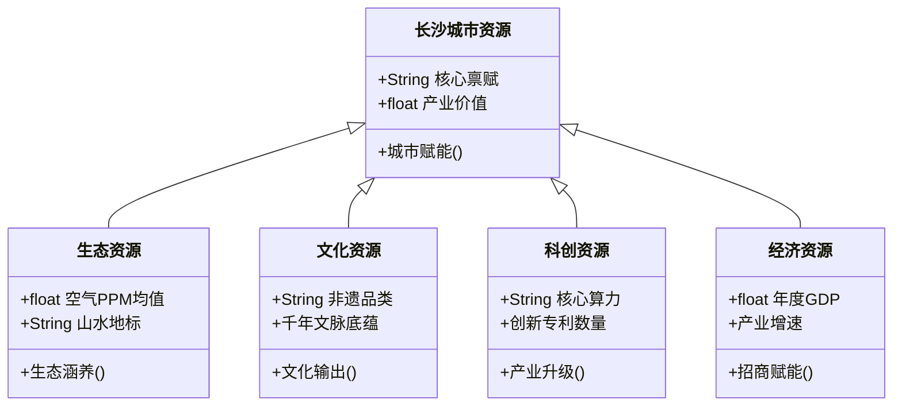

### 4. StateDiagram｜状态图：长沙空气质量动态状态监测

**场景释义**：基于长沙空气PPM监测数据，模拟城市空气质量常态运行、优化、预警全状态流转。

> 注：当前青简 QingJian内置Mermaid旧版本状态图，状态名称内不能直接嵌入括号，采用「英文状态ID:中文描述」写法规避解析报错。

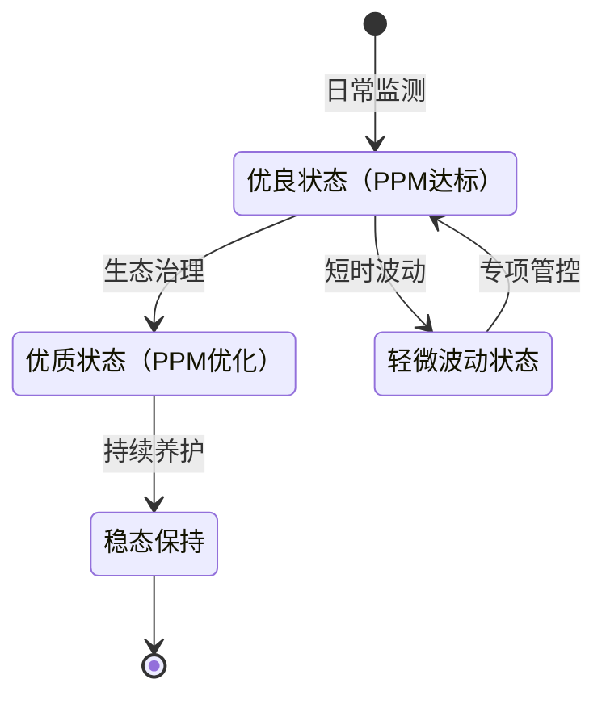

**状态释义**

-   S1：优良状态（PPM达标）：空气质量达标，处于日常监测基准状态
    
-   S2：优质状态（PPM优化）：经过生态治理，空气质量进一步优化
    
-   S3：轻微波动状态：受扰动出现短时污染物小幅上升
    
-   S4：稳态保持：优质空气质量持续稳定维持
    

**流转逻辑**

1. 系统启动，进入优良状态，持续日常监测
    
2. 优良状态经生态治理，升级为优质状态；出现短时波动，则进入轻微波动状态
    
3. 轻微波动状态执行专项管控，恢复至优良状态
    
4. 优质状态经持续养护进入稳态保持，流程结束
    

### 5. ERDiagram｜ER实体关系图：长沙文旅产业实体关联关系

**场景释义**：搭建长沙文旅产业实体关联模型，展示地标、非遗、科创、游客、产业收益的联动关系。

> 注：当前青简 QingJian内置Mermaid旧版本ER语法**不支持实体名、属性名直接使用中文**，关系标签可使用中文；实体与字段中文释义放在代码块下方。

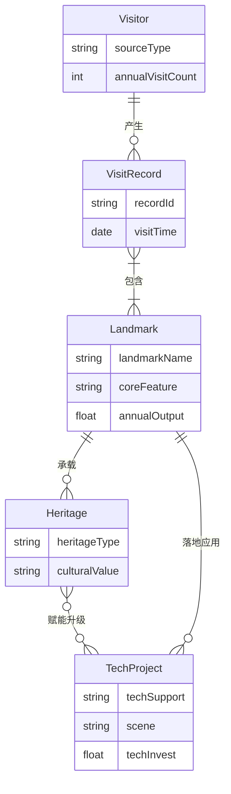

**实体与字段释义**

1. Visitor（游客）：`sourceType`客源类型，`annualVisitCount`年游览量
    
2. VisitRecord（游览记录）：`recordId`记录编号，`visitTime`游览时间
    
3. Landmark（文旅地标）：`landmarkName`地标名称，`coreFeature`核心特色，`annualOutput`年均文旅产值
    
4. Heritage（非遗文化）：`heritageType`非遗品类，`culturalValue`文化价值
    
5. TechProject（科创项目）：`techSupport`技术支撑，`scene`应用场景，`techInvest`科创投入
    

**关联关系释义**

-   Visitor ||--o{ VisitRecord : "产生"：一对多，一名游客可产生多条游览记录
    
-   VisitRecord }|--|{ Landmark : "包含"：多对多，游览记录关联多个文旅地标
    
-   Landmark ||--o{ Heritage : "承载"：一对多，一个文旅地标承载多项非遗文化
    
-   Heritage }o--o{ TechProject : "赋能升级"：多对多，非遗文化接受科创项目赋能升级
    
-   Landmark ||--o{ TechProject : "落地应用"：一对多，一个文旅地标可落地多个科创项目
    

---

### 6. Gantt｜甘特图：长沙数字文博基建项目排期

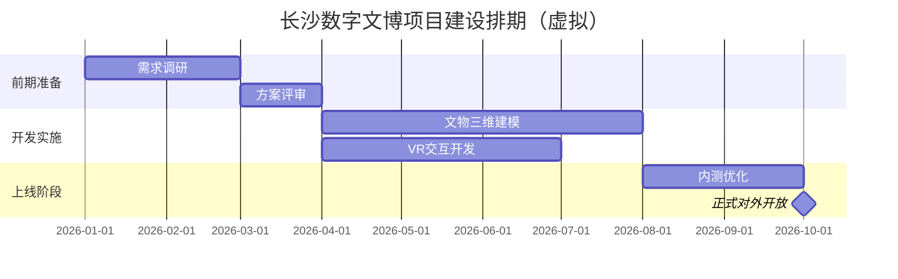

### 7. Pie｜饼图：长沙城市资源结构

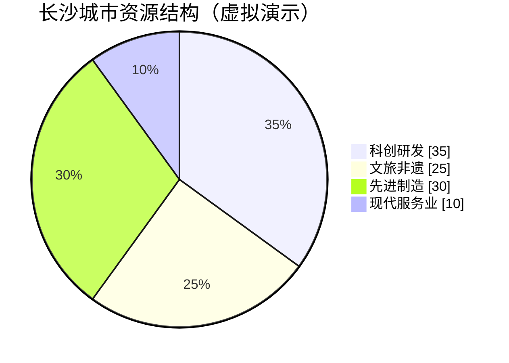

### 8. RequirementDiagram｜需求图：科创平台建设需求

> 标识符英文，中文文本放字符串内

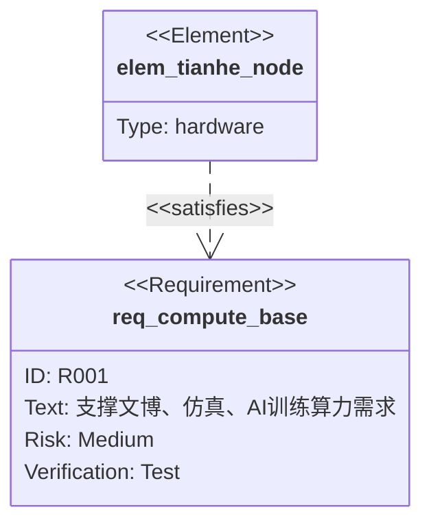

### 9. GitGraph｜Git版本图：项目迭代流程

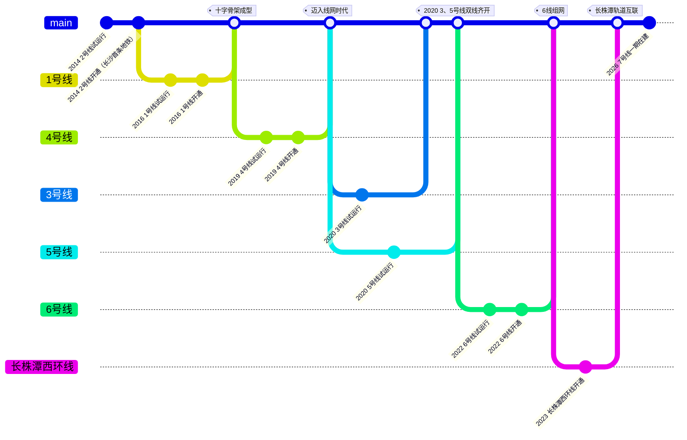

### 10. C4Context｜C4上下文图：长沙科创文旅平台系统

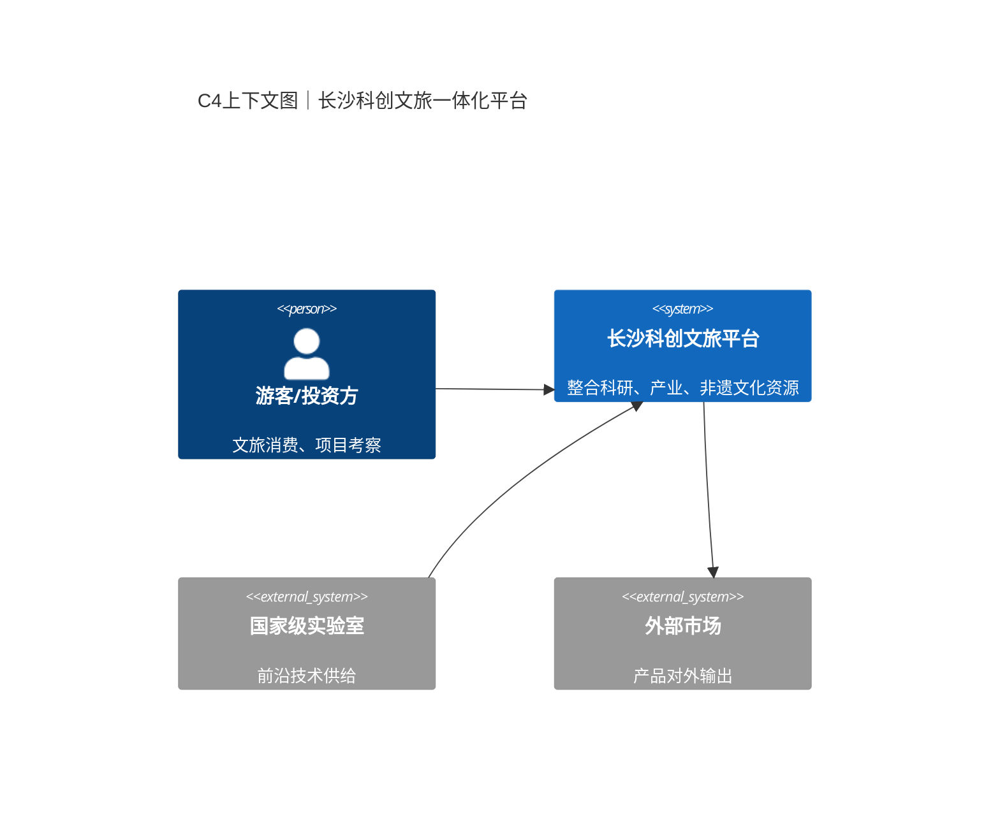

### 11. Mindmap｜思维导图：长沙招商核心要素

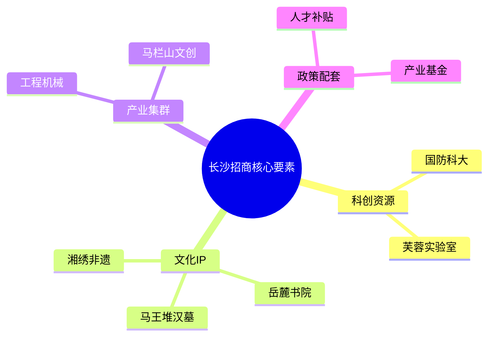

### 12. Timeline｜时间线：长沙科创文旅关键节点

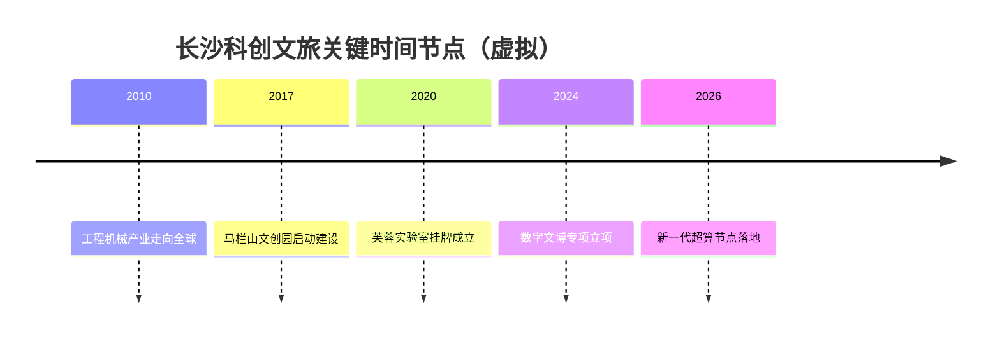

### 13. XYChart｜XY柱状折线图：研发投入与营收（虚拟）

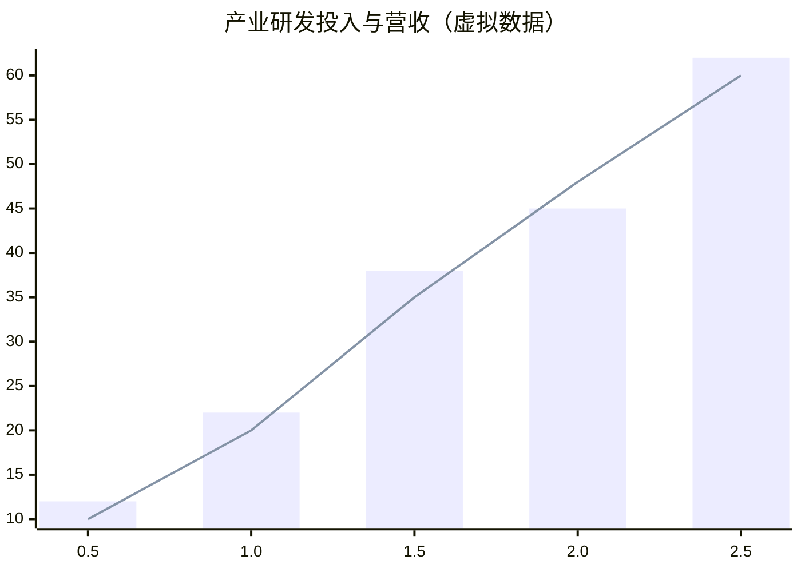

### 14. QuadrantChart｜四象限图：长沙文旅科创项目优先级

**场景释义**：以「实施复杂度、城市价值」为双维度，划分长沙重点项目推进优先级，适配城市规划决策。

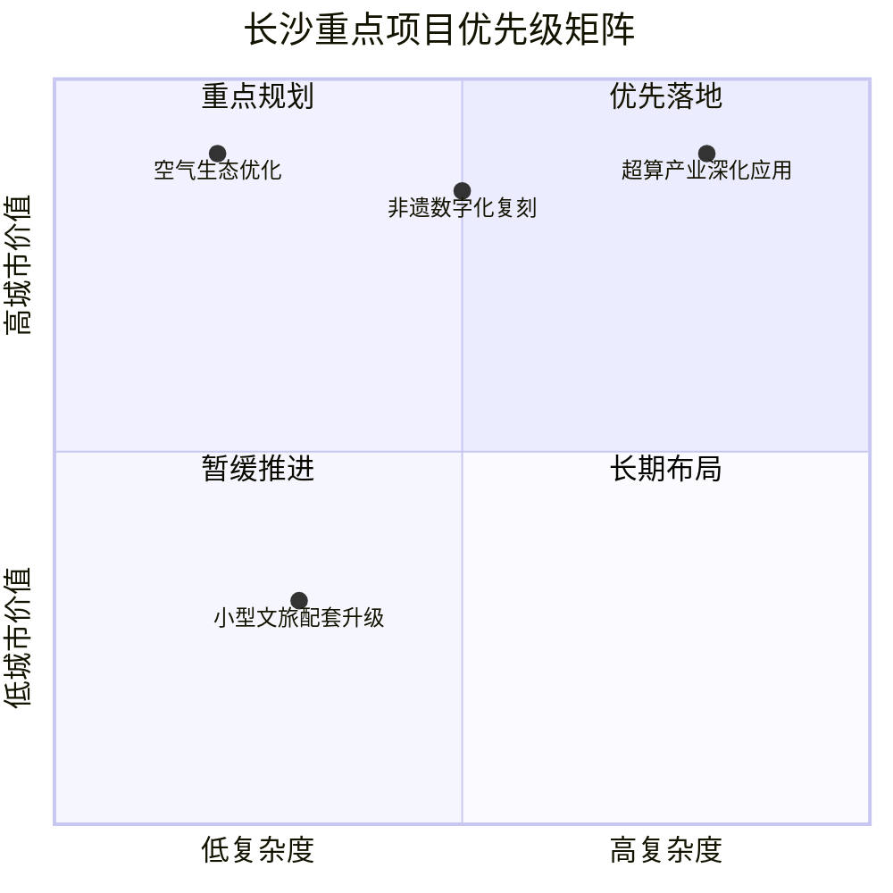

### 15. Packet｜数据包图：超算通信报文结构

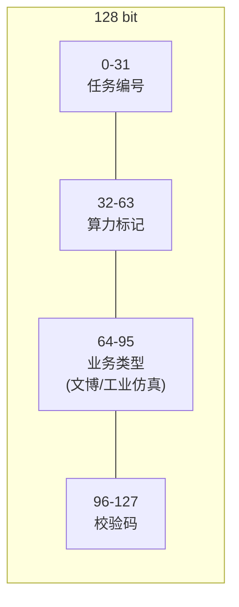

### 16. Sankey｜桑基图：长沙科创资金流向虚拟演示

```mermaid
sankey-beta
市级科创专项资金,高校科研院所,35
市级科创专项资金,科技型企业,50
市级科创专项资金,公共科创平台,15
区县配套科创资金,科技型企业,25
区县配套科创资金,公共科创平台,15
高校科研院所,基础研究项目,22
高校科研院所,产学研联合攻关,13
基础研究项目,科研设备购置,12
基础研究项目,科研人力经费,10
产学研联合攻关,联合技术开发,13
科技型企业,高新技术企业补贴,30
科技型企业,重点研发专项,22
科技型企业,中小科创企业扶持,23
高新技术企业补贴,企业研发投入补助,30
重点研发专项,关键技术攻关,22
中小科创企业扶持,创业补贴+贷款贴息,23
公共科创平台,实验室/技术中心建设,16
公共科创平台,科创孵化载体运营,14
实验室/技术中心建设,场地与仪器建设,16
科创孵化载体运营,孵化器运营补贴,14
```
## 5 建模与乐谱：PlantUML 与 ABC

面向更专业的表达：PlantUML 用文本绘制实体关系、时序、组件与用例图；ABC 是一种纯文本离线乐谱语言，青简将其渲染为五线谱，并支持歌词对位与离线播放。

### 5.1 PlantUML 实体关系图｜长沙创新生态领域模型

**场景释义**：构建长沙创新生态实体关系模型，描述科研院所、产业园区、非遗IP三类核心主体之间技术输送与文化赋能关联。

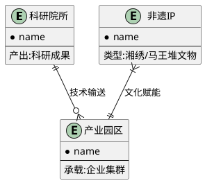

### 5.2 PlantUML 时序图｜长沙超算科创服务流程

**场景释义**：模拟国防科大天河超级计算机，为湖南智能制造、环境监测、文物保护（素纱襌衣数字化修复）提供算力支撑的完整时序流程。

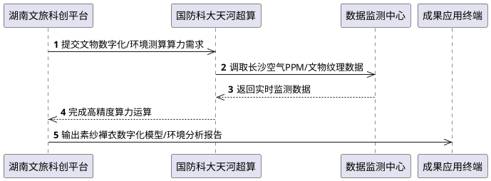

### 5.3 PlantUML 组件图｜长沙科创算力平台架构

**场景释义**：分层搭建长沙科创算力平台，分为算力基础设施层、平台服务层、业务应用层，展示组件间依赖与调用关系。

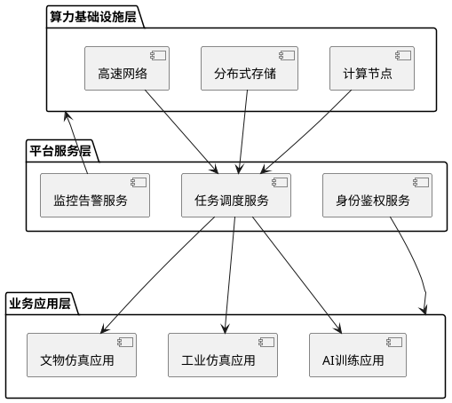

### 5.4 Use Case Diagram｜用例图｜长沙文旅服务体系

**场景释义**：覆盖长沙核心文旅资源（岳麓书院、橘子洲、湖南博物院、湘绣非遗）的游客服务、文化传播、产业赋能全场景用例。

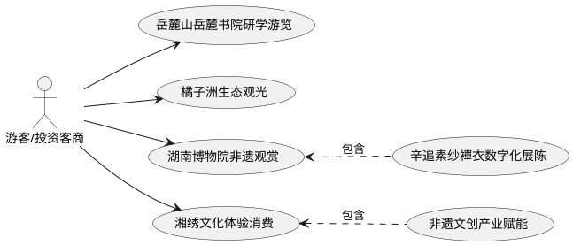

### 5.5 ABC｜湖湘民乐片段演示

```abc
T:长沙湖湘民乐主题片段
C:演示乐谱
K:G
L:1/8
D E G A | G E D2 | D E G B | A G D2 |
```

### 5.6 ABC｜地域五线谱

**语法说明**：ABC 是纯文本离线音乐记谱语言，依靠音符、节拍与歌词映射渲染五线谱；`w:` 实现歌词与音符逐一对位，下划线`_`用于汉字延音，可定制长沙文旅主题乐谱。

> 注：青简 QingJian内置ABCJS渲染库不支持`*`占位休止符，请勿使用。

**场景适配**：原创自由创作《湘韵长沙》乐谱，融汇岳麓书院文脉、橘子洲江景、湘绣非遗、三湘山水意象，适用于长沙文旅展示、城市形象推介场景。

### 完整示例：《湘韵长沙》（原创长沙文旅主题曲，1=F，2/4）

> 说明：ABCJS 歌词渲染规则：音符行后紧跟`w:`歌词行；汉字音节以空格分隔；下划线`_`为原生延音标记，五线谱自动绘制延音线；一行音符对应一行`w:`，音节数量必须与音符数量严格匹配，保证歌词完整渲染，无文字丢失、无多余字符输出。

```abc
X:1
T:湘韵长沙
C:原创文旅词曲
M:2/4
L:1/8
K:F
% 引子：岳麓山清风前奏（无歌词）
C C | D C | G A | G2 |
% 主歌：山水长沙
C D | F G | A G | F2 |
w:岳 麓 凝 文 脉 湘 江_
G A | G F | D C | D2 |
w:映 云 霞 橘 洲 浮 碧_
% 副歌：大美三湘
F F | A G | G F | D2 |
w:浪 古 城 蕴 韶 华 湘_
C D | F G | A C | C2 |
w:绣 织 千 景 汉 衣 载_
% 尾声：山水永续
G A | G F | C D | C2 |
w:古 雅 科 创 兴 楚 地 新_
G A | G F | C D | C2 |
w:潮 耀 长 沙 三 湘 风 月_
G A | G F | C D | C2 |
w:好 盛 景 永 如 画
```

**完整歌词全文**
岳麓凝文脉，湘江映云霞
橘洲浮碧浪，古城蕴韶华
湘绣织千景，汉衣载古雅
科创兴楚地，新潮耀长沙
三湘风月好，盛景永如画

> 写作提示：
> 
> 1.  音符行紧跟`w:`歌词行，严格遵循ABCJS语法规范；
>     
> 2.  不使用不兼容的`*`占位符，仅使用原生`_`延音标记；
>     
> 3.  若每行7个音符，就配套7组音节单元，实现一一绑定；
>     
> 4.  连续两行乐谱歌词要自然接续，连读为：岳麓凝文脉湘江映云霞，语句流畅不割裂；
>     
> 5.  青简 QingJian预览仅展示汉字与延音线，无多余星号，不会出现歌词截断丢失。
>     

**乐谱核心释义（长沙场景）**

-   引子旋律舒缓悠长，烘托岳麓山千年文脉、山林清幽的城市底色；
    
-   主歌节奏轻快灵动，描摹橘子洲湘江碧水、长沙古城烟火气韵；
    
-   副歌旋律昂扬舒展，呼应湘绣非遗之美、科创产业蓬勃发展的城市新风貌；
    
-   无词前奏营造山水静默悠远的意境，歌词与音符精准对位，契合长沙文旅宣传调性。
    

> 版权说明：《湘韵长沙》为本文档原创虚构作品，不存在现成原版歌曲，词曲与ABC乐谱著作权归创作者所有。仅用于学习、演示展示。

---
## 6 代码、HTML 与兼容性

写作中常常需要展示代码片段与富文本效果。青简支持标准围栏代码块（可指定语言高亮），也允许直接混写 HTML；下表给出常见语法在不同渲染器下的兼容性，便于你判断何时可以放心使用高级特性。

行内代码：`markdown-it`、`KaTeX`、`mhchem`、`Mermaid`、`PlantUML`、`abcjs`

```python
# Python示例：长沙科创项目数据统计
city_name = "长沙"
tech_parks = ["马栏山", "金霞经开区"]
cultural_ips = ["岳麓书院", "湘绣", "马王堆汉墓"]

def show_city_info():
    print(f"城市：{city_name}")
    print("产业园区列表：", tech_parks)
    print("文化IP：", cultural_ips)
```

```SQL
-- SQL示例：查询长沙文旅项目数据
SELECT name, category, investment FROM changsha_tourism_project
WHERE type IN ('tech','culture');
```

HTML混写演示：长沙——惟楚有材，于斯为盛

HTML区块说明：可在青简 QingJian内自定义样式，用于汇报页面美化。

⚠️ 不同渲染器对HTML支持程度不同，导出PDF时部分样式会失效。

### 渲染兼容性对照表

| 语法  | 青简 QingJian | Typora | VSCode+插件 | GitHub MD |
| --- | --- | --- | --- | --- |
| KaTeX数学公式 | ✅   | ✅   | ✅   | ❌   |
| mhchem化学公式 | ✅   | ⚠️  | ⚠️  | ❌   |
| Mermaid 10.x全图表 | ✅   | ⚠️部分图表 | ⚠️部分图表 | ⚠️  |
| PlantUML | ✅   | ⚠️  | ⚠️  | ❌   |
| ABCJS五线谱 | ✅   | ❌   | ❌   | ❌   |
| 内嵌HTML | ✅   | ✅   | ✅   | ✅(受限) |
## 7 引用、锚点与提示块

脚注让论证有出处，锚点让长文可导航，提示块让重要提醒不被忽略。

链接：[长沙市人民政府官网（参考链接）](http://www.changsha.gov.cn)

锚点跳转：[回到文档目录](#%E7%9B%AE%E5%BD%95)

脚注示例：
长沙工程机械产业集群规模位居全球前列[^foot1](本描述仅作脚注语法演示，正式汇报请引用官方统计公报。)。

图片语法示例（青简 QingJian支持本地/远程图片）

```

```

> [!NOTE]
>
> 文档说明：本文所有GDP、PPM、算力等数值全部为**虚拟演示数据**，仅用于Markdown语法练习；正式对外汇报务必替换官方权威数据。

> [!TIP]
>
> 渲染配置：青简 QingJian 需要开启KaTeX mhchem扩展；Mermaid全部采用英文标识符保证兼容性。

> [!WARNING]
>
> 招商汇报提醒：涉及长沙经济、科创指标，正式文稿发布前必须核验官方原文，不可直接使用文档虚拟数据。

> [!CAUTION]
>
> 渲染差异提示：mhchem化学公式、Mermaid高级图表、ABC五线谱、PlantUML仅在青简 QingJian等定制渲染环境正常渲染，普通Markdown编辑器无法渲染。

---
## 8 青简扩展：从公式到仿真

除标准 Markdown 之外，青简还内置一组纯前端 Canvas 扩展代码块——函数曲线、化学结构式、物理仿真、数学绘图、化学仿真、天文仿真，全部离线可用、按需懒加载。让"写下来"升级为"动起来"。

### 8.1 chart｜一元函数曲线（mathjs）

```chart
y = sin(x) + sin(3 * x) / 3
xmin = -10
xmax = 10
title = 三角波叠加：y = sin(x) + sin(3x)/3
```

```chart
y = x ^ 2 - 4 * x + 3
xmin = -2
xmax = 6
title = 二次函数 y = x² - 4x + 3
```

### 8.2 smiles｜SMILES 化学结构式（smiles-drawer）

```smiles
CC(C)CC(=O)O
```

```smiles
O=C(O)c1ccccc1O
```

```smiles
c1ccc2cc3ccccc3cc2c1
```

### 8.3 physim｜物化仿真演示

**麦克斯韦速率分布**（拖动滑块调节温度与分子量，红色虚线为最概然速率）：

```physim
type = maxwell
T = 300
m = 28
```

**一级反应动力学**（A→B，拖动滑块调节速率常数 k）：

```physim
type = kinetics
k = 0.5
```

**理想气体粒子碰撞动画**（matter-js 物理引擎，可调粒子数、暂停/继续、重置）：

```physim
type = gas
n = 40
```

**单摆**（拖动滑块调节摆长与初角，动画/静态可切换）：

```physim
type = pendulum
L = 1.0
g = 9.8
angle = 30
```

**抛体运动**（调节初速与仰角，实时显示射程、射高）：

```physim
type = projectile
v0 = 30
angle = 45
```

**简谐振动**（弹簧-质量系统，绘制 x(t) 曲线）：

```physim
type = spring
k = 20
m = 2
A = 0.5
```

**两点电荷电场线**（拖动滑块改变右侧电荷 q₂ 从 -3q 到 +3q）：

```physim
type = efield
q = 1
```

**凸透镜成像**（调节焦距与物距，三条特征光线作图，实像/虚像自动判别）：

```physim
type = lens
f = 3
u = 5
```

---

### 8.4 canvas-math｜数学绘图（mathjs v13 全量）

> 说明：`canvas-math` 支持三种绘图模式：**笛卡尔**（y=f(x)）、**极坐标**（r=f(θ)，θ 用 `theta` 变量）、**参数方程**（x=f(t)、y=g(t)，用 `p` 表示第二个方程）。表达式由 mathjs v13 全量解析（支持符号求导、复数、单位换算等），高分屏 Canvas 抗锯齿。

**笛卡尔曲线**（高斯函数）：

```canvas-math
y = exp(-x^2 / 2) / sqrt(2 * pi)
xmin = -4
xmax = 4
title = 高斯曲线 y = e^(-x²/2)/√(2π)
```

**极坐标玫瑰线**：

```canvas-math
r = 2 * cos(3 * theta)
mode = polar
tmax = 2 * pi
title = 三叶玫瑰线 r = 2cos(3θ)
```

**参数方程**（李萨如曲线）：

```canvas-math
x = 3 * cos(2 * t)
p = 2 * sin(3 * t)
tmin = 0
tmax = 2 * pi
title = 李萨如曲线 x=3cos2t, y=2sin3t
```

---

### 8.5 chemsim｜化学仿真

**酸碱滴定曲线**（pH-V，支持强酸/弱酸，滑块调节酸浓度与 pKa）：

```chemsim
type = titration
c0 = 0.1
ka = 1.8e-5
```

**水的相图**（P-T 示意：气/液/固区域、三相点、临界点）：

```chemsim
type = phase
```

**原子轨道**（氢原子 |ψ|² 截面，1s / 2p / 3d 切换）：

```chemsim
type = orbital
orbital = 2p
```

---

### 8.6 astrosim｜天文仿真

**开普勒行星轨道**（滑块调节偏心率，动画展示掠面速度守恒）：

```astrosim
type = kepler
e = 0.4
```

**黑体辐射谱**（滑块调节温度，普朗克曲线 + 维恩位移标注）：

```astrosim
type = blackbody
T = 5800
```

**月相演示**（地球视角 8 月相动画）：

```astrosim
type = moon
```

---

### 8.7 ABC 五线谱｜离线钢琴播放

> 说明：青简 QingJian 使用 **abcjs（MIT）仅渲染五线谱**，播放由**自研 WebAudio 钢琴合成器**
> （谐波加和模型 + 击弦噪声，本工程原创，MIT）完成——无任何采样文件、无第三方音频依赖，
> 完全离线可用。五线谱下方出现播放条：▶播放 / ⏸暂停 / ⟲重置 / 🔔试听 / 倍速（0.5x~2x）/ 音量。
> 演奏时谱面音符**卡拉 OK 联动**：当前音符红色高亮、已演奏部分灰暗，重置恢复初始谱面。
> WebAudio 要求用户手势触发，首次点击播放/试听按钮即完成解锁。
> 提示：歌词写在 `w:` 行（音节与音符一一对应，`_` 为延音不占音节）。

```abc
X:1
T:歌唱祖国（教学简化记谱）
C:王莘 词曲
M:2/4
L:1/8
K:F
%引子（器乐前奏，无歌词行）
C C C C | C C F E D | F2 z2 |
%副歌一
C C c' A | F C F G |
w:五 星 红 旗 迎 风 飘 扬
F F c' c' | A F G C2 |
w:胜 利 歌 声 多 么 响 亮
A A G F | E D F G |
w:歌 唱 我 们 亲 爱 祖 国
C C c' A | F E D C2 |
w:从 今 走 向 繁 荣 富 强
C C c' A | F C F G |
w:歌 唱 我 们 亲 爱 祖 国
F F G A | F E D C2 |
w:从 今 走 向 繁 荣 富 强
%主歌
C F A C | D D D E |
w:越 过 高 山 越 过 平 原
F G A F | E D C D |
w:跨 过 奔 腾 黄 河 长 江
C F A C | D D D E |
w:宽 广 美 丽 的 土 地_
F E D C | D E F G |
w:是 我 们 亲 爱 的 家 乡
D E F G | A A G F |
w:英 雄 人 民 站 起 来 了
E D C C | C D E F |
w:我 们 团 结 友 爱 坚 强
```

> 记谱规范：①音符行紧跟 `w:` 歌词行，音节数与音符数严格一一对应；②引子为器乐前奏不写歌词行；③跨行歌词自然接续不割裂；④此谱为教学简化记谱（个别长句按八分音符节奏压缩），正式演唱以权威歌谱为准。

---

### 8.8 编辑器特色功能总览

> **📁 打开文件夹 / 文件树**：工具栏「打开文件夹」按钮可将系统目录树挂载到左侧「文件树」页，
> 点击树中 .md / .txt / .html / .epub 即可打开；打开单个文件时显示文件信息卡（类型/大小/相对路径）。
> 
> **📻 网络电台**：工具栏 📻 图标打开右侧电台面板——添加频道（名称+流地址）即可播放
> mp3/aac 音频流或 m3u8 直播流；支持音量/缓冲进度、频道增删、.m3u 批量导入与 JSON 导入导出
> （仅存本机 localStorage）；**不内置任何直播源，链接合法性由用户自担，CORS 限制属远端服务器约束**。
> 
> **🔊 朗读**：预览区顶部朗读条一键朗读——**浏览器语音透传**：本地+在线语音可选，
> Edge 免费在线自然语音（无需申请）与安卓系统 TTS 自动可用；另支持本地音库（Piper 等配置路径）
> 与 Azure 在线语音（配置 Key）；句子级卡拉 OK 高亮、语速/语言可调、自动滚动跟读。
> 
> **📤 导出**：悬浮菜单支持导出 HTML / PDF / Word，可自选本地保存路径；横向大图
> （桑基图、流程图等）自动按画幅完整导出，不截断。
> 
> **📱 移动端**：横竖屏自适应，工具栏按比例缩放，双栏/单栏切换；导出与保存能力
> 视浏览器而定（建议使用 Chromium 内核浏览器以获得完整体验）。

---
---

# 下篇 · LaTeX：学术结构化表达

Markdown 帮你把想法写下来；LaTeX 帮你把想法**立起来**——章节、定理、公式编号、交叉引用、参考文献，构成一座结构严整的建筑。青简用 AST 语义内核理解 LaTeX 文档：不需要安装数 GB 的 TeX 发行版，打开 `.tex` 即可解释渲染；待文稿成熟，再交给标准发行版终审。

## 9 LaTeX 与青简：为什么用结构化表达

LaTeX 的价值不在"排版漂亮"，而在**结构即语义**：一节是一节、一公式有一编号、一个 `\label` 对应全文所有 `\ref`。青简把这一层语义直接解析出来——左侧目录树来自文档结构，公式编号与交叉引用实时双向联动，定理环境自动编号。你只管思考，结构由青简与 LaTeX 共同守护。

青简对 LaTeX 的解释渲染覆盖：AST 语义内核（LaTeX.js 派生）、KaTeX 数学渲染、15 种主流模板识别、120+ 宏包白名单、多文件装配。全部操作离线完成。

## 10 打开与编辑：模板与入口文件

| 操作 | 步骤 |
|---|---|
| 打开单个 `.tex` | 欢迎页「打开文件」→ 选择任意 `.tex` → 自动识别 `\documentclass` 并按 LaTeX 解释模式渲染 |
| 打开模板文件夹 | 欢迎页「打开文件夹」→ 选择模板包目录 → 文件树列出全部文件，`\input/\include` 自动装配 |
| 识别入口文件 | 模板包中**点击主文档**（含 `\documentclass` 的那个 `.tex`）即可进入完整渲染；入口文件在文件树中带「▶ 入口」金标 |
| acmart 特例 | ACM 官方包无现成 `.tex`（源码为 `.dtx` 安装脚本）——青简自动执行 docstrip 提取生成 `sample-*.tex`，点击即可编辑 |

**15 种主流模板入口对照表**

| 模板 | 入口文件（点击即可编辑渲染） |
|---|---|
| IEEEtran | `bare_jrnl.tex`（期刊）／`bare_conf.tex`（会议） |
| revtex（APS） | `revtex4-2` 示例 `tex` 主文档 |
| elsarticle（Elsevier） | `elsarticle-template-num.tex`（编号制）／`elsarticle-template-harv.tex`（著者-年制） |
| acmart（ACM） | `sample-*.tex`（docstrip 自动提取） |
| llncs（Springer） | `llncsdoc.tex` |
| mntp（Nature） | `sn-article.tex`（Spring Nature 期刊模板） |
| ctexart（中文） | `ctex-demo.tex`／`ctex-book-demo.tex` |
| thuthesis（清华学位） | `thuthesis-example.tex`（自动 `\input` 装配 `data/` 各章） |
| memoir | `memoir-demo-sample.tex` |
| beamer | `beamer-demo.tex` |
| tufte | `sample-handout.tex`（讲义）／`sample-book.tex`（书籍） |
| amsart | 主文档 `.tex` |
| KOMA-Script | `scrartcl/scrreprt` 示例主文档 |
| jfm（流体力学） | 主文档 `.tex` |
| article（通用） | 任意 `\documentclass{article}` 主文档 |

## 11 公式：行内、行间、编号与引用

**行内公式**：`$...$`
```
本文介绍 $E=mc^2$ 与 $\frac{\partial \rho}{\partial t} + \nabla \cdot (\rho \mathbf{u}) = 0$。
```

**行间公式**：`$$...$$` 或 `equation/equation*` 环境
```
\begin{equation*}
  \int_{-\infty}^{\infty} e^{-x^2} \, dx = \sqrt{\pi}
\end{equation*}
```

**编号与引用**：`\label`/`\ref` 实时双向联动，改标签全文引用立即刷新
```
\begin{equation} \label{eq:navier}
  \rho\left(\frac{\partial \mathbf{u}}{\partial t} + \mathbf{u}\cdot\nabla\mathbf{u}\right) = -\nabla p + \mu \nabla^2 \mathbf{u}
\end{equation}
由式\eqref{eq:navier} 可见……
```

**unicode-math 命令自动映射**（青简解释模式内置，中文学位论文模板通用）：
`\uppi`→π、`\symup{x}`→正体 x、`\symbf{x}`→粗体 x、`\increment`→Δ、`\dif`→正体 d

## 12 宏包与多文件装配

学术写作几乎离不开宏包：数学、物理、化学、单位各有专属命令。青简维护 120+ 宏包白名单——已覆盖功能的宏包由 AST 内核直接支持，无需安装；未知宏包会在顶部信息条提示「未识别宏包（解释模式跳过，定稿请用发行版）」，**不中断渲染**。长篇论文（学位论文、书籍）则靠 `\input`/`\include` 拆分为多个文件，青简自动装配渲染。

```
\usepackage{amsmath, amssymb}      % 数学（白名单内置）
\usepackage{physics}               % 90+ 物理命令：\bra \ket \dv \pdv \vb \grad \qty 等
\usepackage{mhchem}                % 化学：\ce{2H2 + O2 -> 2H2O}
\usepackage{siunitx}               % 单位：\SI{9.8}{\metre\per\second\squared}
```

- 已覆盖功能的宏包：AST 内核直接支持，无需任何安装；
- 未知宏包：顶部信息条提示「未识别宏包（解释模式跳过，定稿请用发行版）」，**不中断渲染**。

### 12.1 physics 宏包案例（量子力学）

```
\begin{equation}
  \bra{\psi} \hat{H} \ket{\psi} = E
\end{equation}
\begin{equation}
  \dv[2]{x}{t} + \omega^2 x = 0, \qquad \pdv{f}{t} = \vb{\nabla} \cdot \vb{F}
\end{equation}
```

### 12.2 多文件装配（学位论文/书籍）

```
\input{data/chap01}   % 自动展开并渲染（data/ 目录需在打开文件夹范围内）
\include{data/chap02}
```
缺失文件以占位标记提示，不影响其余章节渲染。

## 13 文档结构与目录

结构化表达的最终形态：`\section`/`\subsection`/`\chapter` 自动生成左侧目录树，点击目录任意条目，预览区精确跳转；`\begin{theorem}`/`\begin{proof}` 等定理环境自动编号；beamer 的 `\begin{frame}` 逐帧渲染。

`\section`/`\subsection`/`\chapter` 自动生成左侧目录树，点击目录任意条目 → 预览区精确跳转；
`\begin{theorem}`/`\begin{proof}` 等定理环境自动编号渲染；beamer 的 `\begin{frame}` 逐帧渲染。

## 14 从写作到定稿：差异说明与工作流

青简是**解释模式**的学术工作台：它理解并渲染 LaTeX 的结构与语义，但不是完整 TeX 引擎。下表说明解释渲染与发行版编译的边界，以及每一步该用什么工具。

| 场景 | 青简行为 | 定稿建议 |
|---|---|---|
| `.eps` 插图 | 占位提示，不内联渲染 | 提供同名 PNG/JPG，或用标准 LaTeX 编译 |
| `.bib` 参考文献 | 引用编号+结构占位 | 用 BibTeX/Biber 生成条目后编译 |
| 字体/分页/页眉页码 | 与发行版有差异 | 定稿用 TeX Live/MiKTeX/Overleaf |
| 复杂底层 TeX 原语 | 不支持 | 定稿用标准发行版 |

### 14.1 快捷键与工具栏

| 功能 | 操作 |
|---|---|
| 源码↔预览双向定位 | 点击预览任意段落 → 源码对应行高亮；源码光标行 → 预览段落高亮 |
| 导出 | 顶部「出版」→ 导出 PDF（打印样式）/ 独立 HTML / PNG |
| 查找 | Ctrl+F 跨源码与预览同步定位 |
| 行号 | 顶部「行号」开关 |

## 15 完整案例：一篇 IEEE 论文

把以上能力串起来：下面是一篇完整的 IEEE 期刊论文骨架。在青简中打开该 `.tex`，即可看到双栏期刊版式、公式编号与交叉引用即时呈现。

```
\documentclass[journal]{IEEEtran}
\usepackage{amsmath,amssymb}
\begin{document}
\title{Bare Demo of IEEEtran for Journals}
\author{Michael Shell}
\maketitle
\begin{abstract}
This demo serves as a starter file for IEEE journals.
\end{abstract}
\section{Introduction}
The root mean square of $x(t)$ is:
\begin{equation} \label{eq:rms}
  x_{\mathrm{rms}} = \sqrt{\frac{1}{T}\int_0^T x^2(t)\,dt}
\end{equation}
See Eq.~\eqref{eq:rms} for details.
\end{document}
```
→ 打开文件 → 选择该 `.tex` → 双栏期刊版式、公式编号、交叉引用即时呈现。

---

## 附录：语法速查索引

-   标题：`# H1` `## H2` `### H3`
    
-   文本样式：`**粗体**` `*斜体*` `==高亮==` `~~删除线~~`；HTML 下划线、ruby 注音、kbd 按键、span 自定义样式
    
-   列表：`-` 无序列表；`1.` 有序列表；`- [x]` 任务列表
    
-   表格对齐：`左 :---` `居中 :---:` `右 ---:`
    
-   数学公式：行内 `$...$`；块级 `$$ ... $$`
    
-   化学公式：行内 `$\ce{}$`；块级 `$$\ce{}$$`
    
-   Mermaid： mermaid 围栏，16 大类图表；中文节点文本建议双引号包裹（青简 QingJian 已做中文包容）
    
-   PlantUML： plantuml 围栏；实体关系图、时序图、组件图、用例图四类示例；可加 `!theme vibrant` 主题
    
-   ABC 乐谱： abc 围栏；`w:` 歌词行与音符一一对应，`_` 为延音
    
-   脚注：`[^id]` + `[^id]: 说明`
    
-   提示块：`> [!NOTE / TIP / IMPORTANT / WARNING / CAUTION]`
    

### 扩展代码块速查

> -   `chart`：第一行函数表达式 `y = ...`（mathjs 支持 `sin/cos/tan/exp/log/abs/sqrt/^` 等），可选 `xmin= / xmax= / ymin= / ymax= / title=`
>     
> -   `canvas-math`：`y=…`（笛卡尔）/ `r=…` + `mode=polar`（极坐标）/ `x=…` + `p=…`（参数方程），可选 `xmin/xmax/ymin/ymax/tmin/tmax/title`
>     
> -   `smiles`：直接写 SMILES 字符串（如 `CCO`、`c1ccccc1`）
>     
> -   `physim`：`type = maxwell | kinetics | gas | pendulum | projectile | spring | efield | lens`，可选 `T= / m= / k= / n= / L= / g= / angle= / v0= / A= / q= / f= / u=` 参数
>     
> -   `chemsim`：`type = titration | phase | orbital`，可选 `c0= / ka= / orbital=`
>     
> -   `astrosim`：`type = kepler | blackbody | moon`，可选 `e= / T=`
>     
> -   所有扩展库（mathjs / matter / smiles-drawer / mermaid / abcjs / viz）均离线可用、按需懒加载
>     

### LaTeX 速查

- 文档类：`\documentclass[journal]{IEEEtran}`、`\documentclass{article}`、`\documentclass[doctor]{thuthesis}`
- 宏包：`\usepackage{amsmath, amssymb}`、`\usepackage{physics}`、`\usepackage{mhchem}`、`\usepackage{siunitx}`
- 结构：`\section{}`、`\subsection{}`、`\chapter{}`、`\begin{theorem}` / `\begin{proof}`
- 公式：行内 `$...$`；行间 `$$...$$`；环境 `equation` / `equation*` / `align` / `cases`
- 交叉引用：`\label{key}` 与 `\ref{key}`、`\eqref{key}` 实时双向联动
- 多文件：`\input{path}` / `\include{path}` 自动装配
- 模板入口：acmart 自动 docstrip 提取；IEEEtran 点击 `bare_jrnl.tex`；thuthesis 点击 `thuthesis-example.tex`

---

## 结语

从一行 Markdown 到一篇结构完整的 LaTeX 论文，青简提供的不是引擎，而是一张始终在线的写字台：**轻量不是妥协，是尊严的最小单位；草稿纸不是起点，是思想正在发生的现场。** 把想法写下来，把结构立起来——剩下的，交给青简。

> 以字节为简，承千年竹帛之思；离线执笔，守学者精神之域。
> ▶ 青简 · QingJian —— 离线是底线｜轻量是尊严｜草稿纸，是思考自由唯一的家园。
